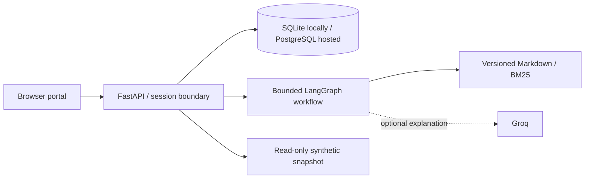

# Northstar IT Service Desk

A working public helpdesk demonstration built around a fictional company. Visitors can search IT knowledge, ask a bounded LangGraph assistant, inspect simulated service health, create session-scoped tickets, and explore linked historical support records.

**Release scope:** public demonstration with synthetic data. Real identity verification, password resets, live monitoring, and ITSM integrations are deliberately not connected. This is not an enterprise production certification.

## Run locally

Requires Python 3.12. No Node build, GPU, model download, or API key is needed.

```powershell
python -m venv .venv
.venv\Scripts\python.exe -m pip install -r requirements.txt
.venv\Scripts\python.exe -m uvicorn api:app --port 8000
```

Open [http://localhost:8000](http://localhost:8000). Local SQLite is created automatically. On Linux/macOS use `.venv/bin/python` instead.

Copy `.env.example` to `.env` only when configuring overrides. Do not overwrite an existing secret file. For optional Groq explanations, set `GROQ_API_KEY` and explicitly set `LLM_PROVIDER=groq`. With no provider, the application returns useful source-backed procedures.

## Guided resolution

Three persistent workflows investigate and resolve fictional VPN, account-access and software issues. Start one from an assistant suggestion or open an existing ticket and select **Start a guided demo workflow**. LangGraph retrieves procedures, inspects the isolated resource and asks Groq to propose an allowed next tool. A policy gate and explicit confirmation protect each mutation. Tool verification and employee confirmation are required before resolution. Failures go to a clearly labeled fictional specialist queue.

Without a key, on timeout or quota exhaustion, the same safe workflow uses its documented deterministic plan. The UI identifies the mode on each case. See [workflow design and demo script](docs/AGENT_WORKFLOWS.md).

## Experience

- **Overview:** personal ticket counts, knowledge catalog and labeled service snapshot.
- **Support assistant:** local BM25 retrieval, cited source cards, optional AI explanations, graceful provider fallback.
- **My tickets:** persistent creation, ownership checks, details and retry-safe submission.
- **Knowledge center:** searchable employee guides and service-desk runbooks.
- **Service status:** 20 simulated services and 40 incident/maintenance records.
- **Sample service desk:** 600 read-only historical tickets linked to 150 fictional employees, 250 assets and knowledge articles.

The source-controlled snapshot is dated 20 October 2026. Sample records are not customer data and are not live telemetry. Names are generated combinations; email addresses use the reserved `.example` domain.

## Architecture



The public frontend is plain HTML/CSS/JavaScript served by FastAPI. This avoids a separate frontend build/runtime and fits constrained free-tier hosting. The model cannot execute mutation tools. Ticket creation is a distinct, validated API action after explicit form confirmation.

## Deployment

Use **Render Free + Supabase Free**. Start with `LLM_PROVIDER=none`, then optionally enable Groq. The app refuses SQLite when Render is detected, because local Render files are ephemeral.

See [deployment instructions](docs/DEPLOYMENT.md), [operations runbook](docs/OPERATIONS.md), and [security model](docs/SECURITY.md). Free hosting can sleep, pause, or hit limits; it is not an always-on SLA.

## Verification

```powershell
.venv\Scripts\python.exe -m unittest discover -s tests -v
node --check web/app.js
```

CI runs regression tests, JavaScript syntax checking and dependency auditing. The suite covers session isolation, authentication, expiry, idempotency including parallel retries, rate limits, provider fallback, injection attempts against account actions, retrieval cases, and synthetic-record consistency.

## Repository map

| Path | Purpose |
| --- | --- |
| `api.py` | HTTP routes, request validation, limits, security headers, static portal |
| `web/` | Responsive frontend with no third-party scripts |
| `src/workflows.py` | Persistent diagnosis, tool policies, verification and case transitions |
| `src/llm.py` | Bounded Groq JSON planning |
| `src/agent.py` | Bounded retrieval/explanation graph |
| `src/database.py` | Schema bootstrap and transactional session-owned records |
| `src/rag.py` | In-memory BM25 index; refresh replaces rather than appends |
| `knowledge_base/ns-*.md` | 60 active guides and runbooks |
| `knowledge_base/archive/` | Six original prototype notes, excluded from retrieval |
| `data/demo.json` | Reproducible fictional organization snapshot |
| `scripts/seed_demo.py` | Deterministic dataset generator |
| `tests/` | Security and workflow regression tests |
| `render.yaml`, `Dockerfile` | Deployment configuration |
| `docs/` | Architecture, API, security, deployment, operations and project brief |

The existing Streamlit `app.py` is retained as an optional **legacy local interface**; install `requirements-streamlit.txt` to use it. It is not the production entry point and does not provide the new portal's persistent session workflow. The unsafe standalone tool server is retired; no MCP compatibility is claimed.

## Demo limits and privacy

Defaults: 50 new sessions/day globally, 10 new sessions/hour per observed IP, 80 messages and 20 tickets/session, 8 chat requests/minute/session, and 100 optional model calls/day globally. Provider calls are limited to two concurrently and 1,800 completion tokens each. This is a request/token bound, not a currency budget.

Sessions expire after seven days. Cleanup runs at startup and new-session creation. The visitor can delete their session and related records. Browser tab storage holds an opaque bearer token; database storage contains only its SHA-256 digest. Operators can access stored records, so visitors are told to use fictional details only.

## Documentation

- [Project brief](docs/PROJECT_BRIEF.md)
- [Architecture and data model](docs/ARCHITECTURE.md)
- [API reference](docs/API.md)
- [Security review](docs/SECURITY.md)
- [Deployment guide](docs/DEPLOYMENT.md)
- [Operating runbook](docs/OPERATIONS.md)
